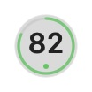
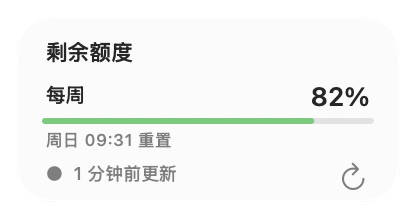
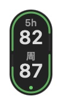
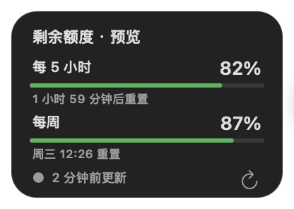

<p align="center">
  
</p>

<h1 align="center">Codex HUD</h1>

<p align="center"><strong>把 Codex 剩余额度，放在桌面一角。</strong></p>

<p align="center">小球常驻桌面，点击查看详情。每 5 小时与每周额度，一眼就知道。</p>

<p align="center">
  <a href="https://github.com/WasdTornado/codex-hud-releases/releases/latest"><strong>下载 macOS 版</strong></a>
  &nbsp;·&nbsp;
  <a href="#下载安装">安装说明</a>
  &nbsp;·&nbsp;
  <a href="#应用更新">如何更新</a>
  &nbsp;·&nbsp;
  <a href="docs/DEVELOPMENT.md">开发文档</a>
</p>

<p align="center"><sub>macOS 26+ &nbsp; / &nbsp; Apple Silicon &nbsp; / &nbsp; 原生 Swift &nbsp; / &nbsp; MIT License</sub></p>

## 看一眼，就够了

<table>
  <tr>
    <th align="center" width="25%">平时，只留一个小球</th>
    <th align="center" width="75%">点击，查看额度与重置时间</th>
  </tr>
  <tr>
    <td align="center"></td>
    <td align="center"></td>
  </tr>
</table>

以上为 **1.1.2 实际运行截图**，数值是拍摄时的账号状态。小球本体仅 **36 × 36 pt**；截图以 Retina 像素展示，含窗口透明边距。

<details>
<summary><strong>同时有 5h 和周额度？查看竖版胶囊与深色外观</strong></summary>

<br>

<table>
  <tr>
    <th align="center" width="25%">5h 在上，周在下</th>
    <th align="center" width="75%">详情中同时查看两个周期</th>
  </tr>
  <tr>
    <td align="center"></td>
    <td align="center"></td>
  </tr>
</table>

这组图片来自独立原生预览，**82 / 87 为演示数据**。正式应用按接口实际返回的周期自动选择小球或胶囊，双额度胶囊本体为 **36 × 72 pt**。

</details>

## 它能做什么

| 功能 | 使用体验 |
| --- | --- |
| 自动识别额度周期 | 只有一种额度时显示小球；同时有 5h 和周额度时显示竖版胶囊 |
| 桌面随时可见 | 置顶悬浮，拖动调整位置，也可从菜单靠左或靠右停靠 |
| 详情按需展开 | 点击查看剩余百分比、重置时间、同步状态；点击外部或按 Esc 收起 |
| 菜单栏数字环 | 圆环内直接显示剩余额度；双周期时优先显示 5h |
| 跟随系统外观 | 浅色使用原生磨砂，深色使用不透明石墨色 |
| 同步状态清晰 | 每 5 分钟刷新额度；失败时保留上次成功数据，并提示状态 |
| 应用内更新 | 发现新版本时提示，由你确认下载和安装 |

应用以菜单栏工具运行，**不占 Dock**。额度读取通过本机 Codex CLI 完成，不依赖 Electron、Node 或 npm。

## 下载安装

**运行要求：Apple Silicon（M 系列芯片）· macOS 26 或更新版本。** 当前不提供 Intel / Windows / Linux 安装包。

1. **先登录 Codex。** 在自己的电脑安装并登录 Codex 应用或 CLI；Codex HUD 使用已有登录状态。
2. **[打开最新版下载页](https://github.com/WasdTornado/codex-hud-releases/releases/latest)。** 在 Assets 中下载 `Codex-HUD-<版本>-arm64.dmg`。普通使用请选择 **DMG**，无需下载 ZIP 或 Source code。
3. **拖入应用程序。** 打开 DMG，将 `Codex HUD.app` 拖入 `Applications`，然后从“应用程序”或 Spotlight 启动。

启动后，桌面会出现额度小球或胶囊，顶部菜单栏会出现额度数字环。首次同步需要稍等片刻。

<details>
<summary><strong>首次打开被 macOS 拦截？</strong></summary>

当前分发包使用临时签名，**尚未进行 Apple Developer ID 签名和公证**。请先确认下载自本仓库，并核对 Release 中的 SHA256 校验文件。

确认来源可信且文件未被篡改后，按 [Apple 官方说明](https://support.apple.com/zh-cn/102445)处理：尝试打开应用后，在“系统设置 → 隐私与安全性”中查看是否有“仍要打开”入口。企业管理的 Mac 可能需要联系管理员。

如果系统报告应用损坏或包含恶意内容，请停止打开并提交 [Issue](https://github.com/WasdTornado/codex-hud-releases/issues)。

</details>

## 日常使用

| 操作 | 结果 |
| --- | --- |
| 点击小球 / 胶囊 | 展开或收起详情 |
| 拖动小球 / 胶囊 | 调整桌面位置，位置自动保存 |
| 点击菜单栏数字环 | 刷新额度、停靠、检查更新、查看关于或退出 |
| 点击详情中的刷新按钮 | 立即重新读取额度 |
| 点击外部或按 Esc | 收起详情 |

快捷键：`⌘R` 刷新、`⌘I` 详情、`⌘[` 靠左、`⌘]` 靠右、`⌘Q` 退出。快捷键在应用获得键盘焦点时生效。当前设置入口集中在菜单栏，暂无独立设置页面。

## 应用更新

**已经安装 1.1.0 或更新版本：**

1. 点击顶部菜单栏的 Codex HUD 数字环。
2. 选择“检查更新…”；发现新版后，菜单也会显示更新入口。
3. 按更新窗口提示下载并安装，应用会验证更新包签名并重启。

启用“自动检查更新”后，应用每 **6 小时**后台检查一次，发现新版时显示提示；不会未经确认自动安装。也可以随时手动检查，无需让同事重新传安装包。

**1.0.5 及更早版本：** 先从 [Releases](https://github.com/WasdTornado/codex-hud-releases/releases/latest) 手动安装一次新版，此后即可使用应用内更新。

| 刷新项目 | 频率 |
| --- | --- |
| 额度数据 | 每 5 分钟；启动、唤醒和手动刷新时立即请求 |
| 应用版本 | 自动检查开启时每 6 小时，也可手动检查 |

## 额度与隐私

- 这里显示的是 **Codex 接口返回的额度**，不代表 ChatGPT 所有模型的聊天额度；具体周期取决于账号实际返回的数据。
- 小球中的数字表示**剩余百分比**，为节省空间省略 `%`；详情中保留完整百分比。
- 账号凭据由 Codex 自身管理，不随本项目源码或安装包分发。Codex HUD 不将账号数据上传到本项目。
- 网络或登录异常时，应用会保留上次成功数据并标记状态；“最近更新”指成功读取的时间。

## 从源码构建

需要 Xcode（默认路径 `/Applications/Xcode.app`，SDK 支持 macOS 26）和 Python 3：

```sh
git clone https://github.com/WasdTornado/codex-hud-releases.git
cd codex-hud-releases
python3 scripts/test.py
python3 scripts/build.py
```

产物为 `build/Codex HUD.app`。构建脚本自动下载并校验固定版本的 Sparkle，图标由 Xcode actool 编译。更多结构、预览与贡献说明见 [开发文档](docs/DEVELOPMENT.md)。

源码在 **main** 维护，Releases Assets 仅提供安装与在线更新所需文件。GitHub 自动生成的 Source code 是标签归档；历史 v1.1.0 / v1.1.2 标签早于源码导入，完整源码请查看 main。维护与发布步骤见 [发布流程](docs/RELEASING.md)。

---

由 **wasdTornado** 维护，采用 [MIT License](LICENSE)。第三方版权与条款见 [THIRD_PARTY_NOTICES.md](THIRD_PARTY_NOTICES.md)。Codex HUD 是独立社区工具，与 OpenAI 无隶属或官方背书关系。
