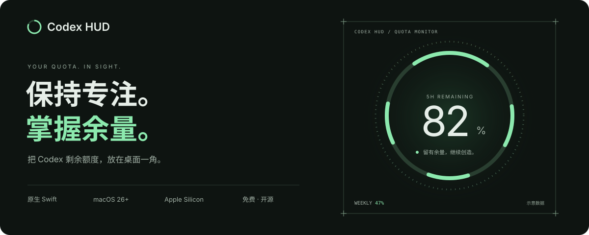
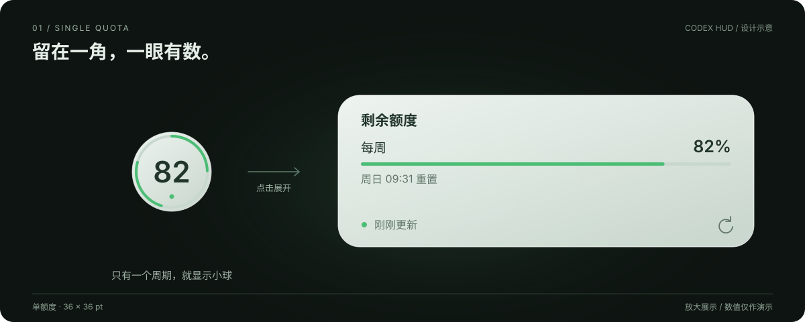
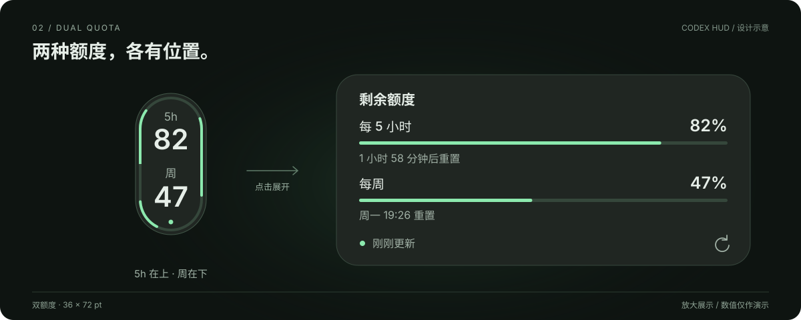

  

  

<h1 align="center">Codex HUD</h1>

<strong>小小一角。心中有数。</strong>

小球常驻桌面，点击查看详情。每 5 小时与每周额度，一眼就知道。

  <a href="https://wasdtornado.github.io/codex-hud-releases/"><strong>访问官网 ↗</strong></a>
  &nbsp; · &nbsp;
  <a href="https://github.com/WasdTornado/codex-hud-releases/releases/download/v1.1.3/Codex-HUD-1.1.3-arm64.dmg"><strong>直接下载 v1.1.3 DMG ↓</strong></a>
  &nbsp; · &nbsp;
  <a href="#下载安装">安装说明</a>
  &nbsp; · &nbsp;
  <a href="#应用更新">应用更新</a>

macOS 26+ &nbsp; / &nbsp; Apple Silicon &nbsp; / &nbsp; 原生 Swift &nbsp; / &nbsp; MIT 开源

> **先体验，再安装。** [打开官网](https://wasdtornado.github.io/codex-hud-releases/)，试试额度展开、单／双周期和浅深外观。官网与下方设计展示均使用演示数值，实际额度以你的账号为准。

## 看一眼，就够了

### 单额度 · 留在一角，一眼有数

只有一种额度时，显示 **36 × 36 pt** 的小球。点击展开详情，查看剩余百分比、重置时间和同步状态。

### 双额度 · 5h 在上，周在下

同时有每 5 小时和每周额度时，自动显示 **36 × 72 pt** 的竖版胶囊。两个周期各有独立的外缘进度，点击即可同时查看详情。

以上为与官网风格一致的设计示意，已放大展示；82 / 47 为演示数值，并非实时用量。应用按账号实际返回的周期自动选择小球或胶囊，外观跟随系统切换。

## 它能做什么

- **额度随时可见**：自动识别单／双周期，菜单栏数字环同步显示余量。
- **小巧不打扰**：置顶悬浮、自由拖动、左右停靠，也可从菜单栏隐藏桌面浮窗。
- **点击看详情**：查看剩余百分比、重置时间和同步状态。
- **跟随系统外观**：浅色磨砂，深色石墨；以菜单栏工具运行，不占 Dock。
- **自动刷新与更新**：额度每 5 分钟同步，支持应用内检查和安装新版本。

## 下载安装

**Apple Silicon（M 系列芯片）· macOS 26 或更新版本。**

1. 在电脑上安装并登录 **Codex 应用或 CLI**。
2. **[下载 v1.1.3 DMG](https://github.com/WasdTornado/codex-hud-releases/releases/download/v1.1.3/Codex-HUD-1.1.3-arm64.dmg)**，打开后将 `Codex HUD.app` 拖入 `Applications`。
3. 启动应用，等待首次同步。点击桌面小球查看详情，点击菜单栏数字环进行设置。

### 首次打开被 macOS 拦截？

当前安装包**尚未经过 Apple Developer ID 签名和公证**。确认下载自本仓库并核对 Release 中的 SHA256 后，可按 [Apple 官方说明](https://support.apple.com/zh-cn/102445)，在“系统设置 → 隐私与安全性”中查看“仍要打开”入口。若提示应用损坏或含恶意内容，请停止打开并[反馈问题](https://github.com/WasdTornado/codex-hud-releases/issues)。

## 应用更新

点击 **菜单栏数字环 → 检查更新…**，按提示下载安装。启用自动检查后，每 **6 小时**检查新版本，安装前会征求确认。1.0.5 及更早版本需先手动安装一次新版。

## 关于项目

显示的是 **Codex 接口返回的剩余额度**，不代表 ChatGPT 所有模型的聊天额度。账号凭据由本机 Codex 管理，不上传到本项目；同步失败时保留上次成功数据并提示状态。

欢迎点一颗 **Star**，或通过 [Issues](https://github.com/WasdTornado/codex-hud-releases/issues) 分享建议。开发与维护请查看 [开发文档](docs/DEVELOPMENT.md)、[发布流程](docs/RELEASING.md)和[官网说明](Website/README.md)。

---

由 **wasdTornado** 维护 · [MIT License](LICENSE) · [第三方声明](THIRD_PARTY_NOTICES.md)。独立社区工具，非 OpenAI 官方应用。
